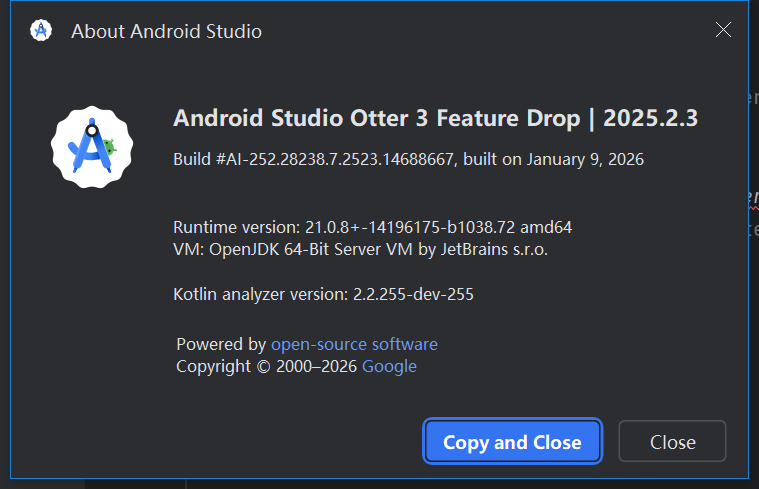
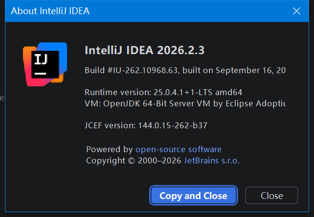
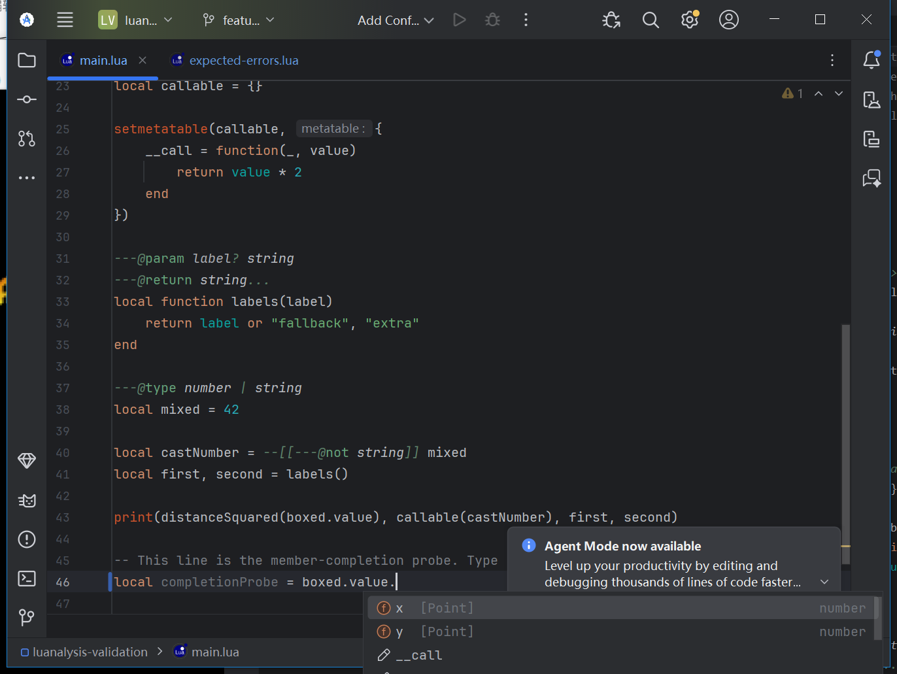
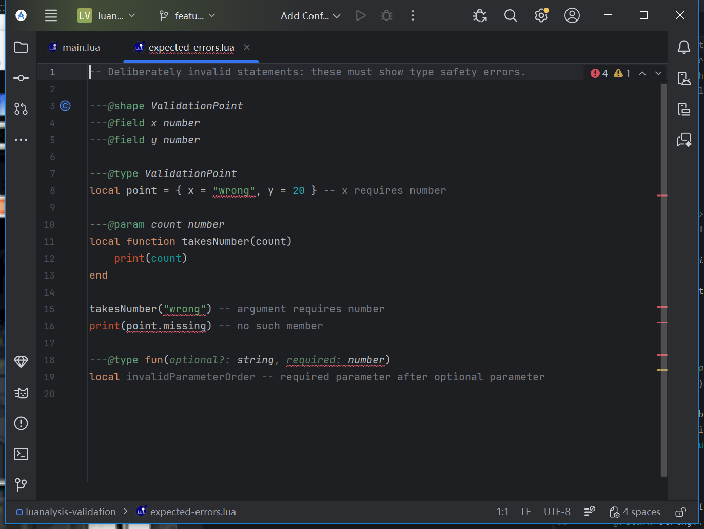
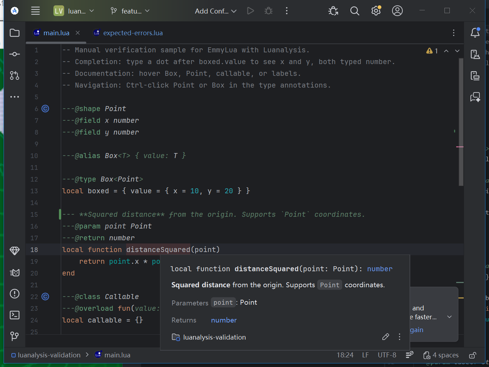
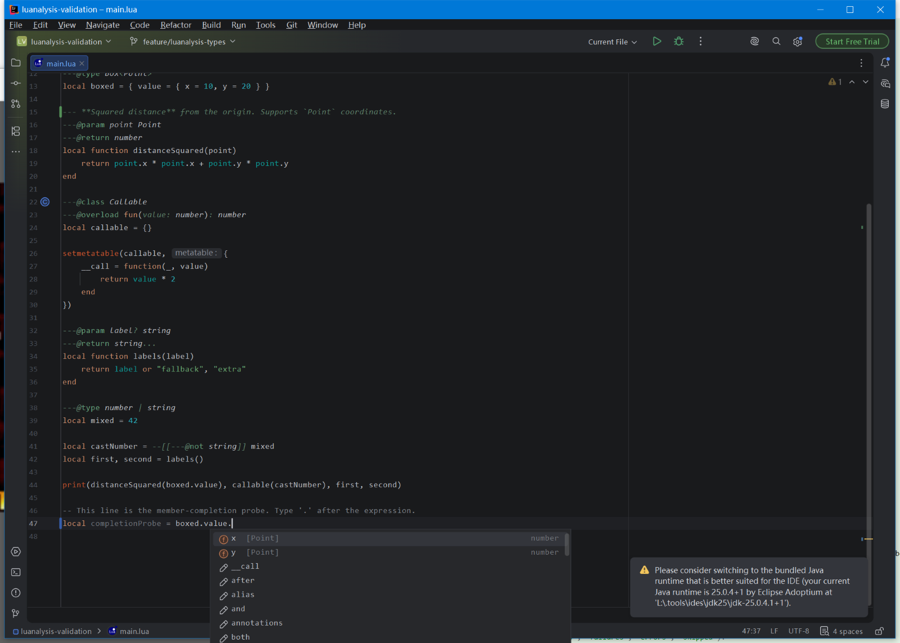
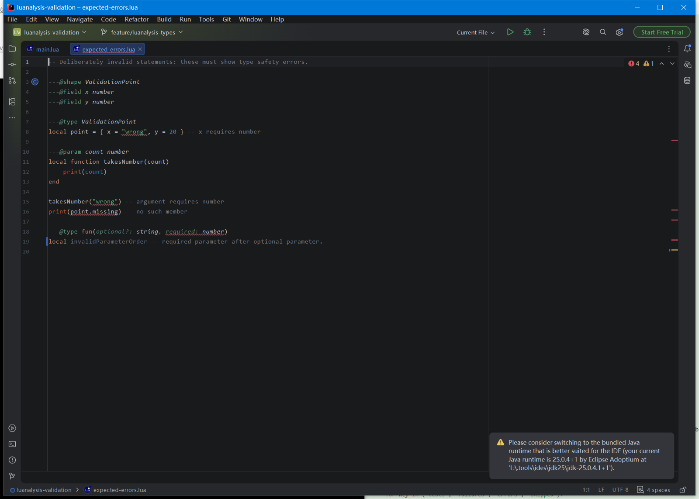
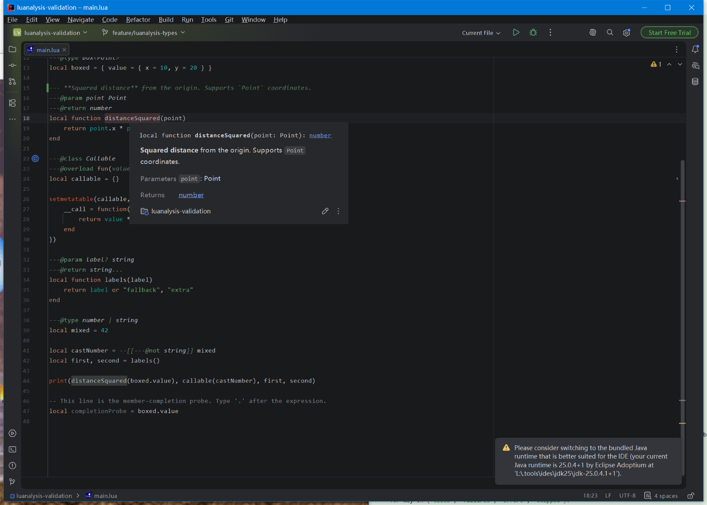

# Weitp Lua 1.5.1 release validation

Date: **2026-10-14**. Plugin ID: **`com.weitp`**. Display name: **Weitp Lua**.
The release ZIPs come from source commit
`2666e8a82071612b41308ef02425cefe01eb42b6` and the successful
[release CI run](https://github.com/ClarkWain/IntelliJ-EmmyLua/actions/runs/38511970766).
Later release-documentation changes do not change the plugin binaries.

## Artifacts

| Package | SDK used to compile | Declared platform range | Bytes |
| --- | --- | --- | --- |
| `Weitp-Lua-1.5.1-IDEA2025.zip` | IDEA 2025.1.7.2 | 251–253 (`251` / `253.*`) | 8,877,268 |
| `Weitp-Lua-1.5.1-IDEA2026.zip` | IDEA 2026.1.5 | 261–262 (`261` / `262.*`) | 8,877,996 |

SHA-256:

```text
fe9931610c7977b048ccb75d979f4f8fc1ae25c0078c33e653df0229ec68e777  Weitp-Lua-1.5.1-IDEA2025.zip
c0e84804b8f3410c55dfba04bc55823c0ba1842bad83a20260bf09bc85048876  Weitp-Lua-1.5.1-IDEA2026.zip
```

Both archives were inspected: one `Weitp-Lua` root, one plugin descriptor, correct
ID/name/version/build bounds, Lua definitions and packaged Windows/macOS/Linux
native debugger libraries. The ZIPs installed in the editor checks below are
these exact CI archives, rather than packages recompiled against a newer SDK.

## Automated regression and compatibility checks

Each CI target passed **109 tests** across **26 suites**, with **0 failures,
0 errors and 0 skipped**. The 47-case type-safety suite covers shapes, constrained
generics, recursive/generic aliases, indexed fields, callable classes, optional
parameters, casts, `self`, overloads and variadic results. Completion, parser,
standard libraries, language levels, rename, file movement, structure, formatting
and concurrent resolution also passed.

IntelliJ Plugin Verifier **1.410** checked these exact binaries:

| Package | IDEA version | Build | Compatibility problems | Internal API usages | Remaining warnings / deprecated / experimental usages |
| --- | --- | --- | --- | --- | --- |
| 2025 | 2025.1.7.2 | IU-251.29188.72 | 0 | 0 | 1 / 24 / 21 |
| 2025 | 2025.2.6.3 | IU-252.28539.97 | 0 | 0 | 1 / 24 / 21 |
| 2025 | 2025.3.6.1 | IU-253.33813.55 | 0 | 0 | 1 / 26 / 21 |
| 2026 | 2026.1.5 | IU-261.27258.48 | 0 | 0 | 1 / 32 / 21 |
| 2026 | 2026.2.3 | IU-262.10968.63 | 0 | 0 | 1 / 33 / 21 |

No verifier failure categories were suppressed. The remaining compatibility
warning concerns the bundled upstream Markdown library. Deprecated and
experimental API use remains visible for future platform updates.

The same source also passed **109/109** local tests using the installed Android
Studio 252 SDK, and **109/109** using the downloaded IDEA 262 SDK. These local
SDK builds are additional checks; the published archives are the CI builds above.
Machine-readable artifact hashes, test totals and verifier verdicts are in
[release-summary.json](validation/release-summary.json). Full reports are attached
to the successful CI run as `validation-IDEA2025` and `validation-IDEA2026`.

## Native Windows editor checks

The final archives were extracted into private plugin directories, with separate
IDE configuration/system/log directories. Startup logs identify the loaded
custom plugins as `Weitp Lua (1.5.1-IDEA2025)` and
`Weitp Lua (1.5.1-IDEA2026)`. Existing user IDE settings and plugins were preserved.

| Application | Exact build | Runtime | Installed release ZIP |
| --- | --- | --- | --- |
| Android Studio Otter 3 Feature Drop 2025.2.3 | AI-252.28238.7.2523.14688667 | bundled JBR 21.0.8+-14196175-b1038.72 | 2025 |
| IntelliJ IDEA 2026.2.3 | IU-262.10968.63 | Eclipse Temurin 25.0.4.1+1-LTS | 2026 |





In **both** applications:

- The Lua sample project opened and completed indexing.
- `Box<Point>.value` completion offered **x** and **y**, both typed **number**.
- The invalid sample showed exactly four type-safety errors: wrong shape field
  type, wrong function argument, undeclared member and a required parameter after
  an optional parameter.
- Quick Documentation displayed the function signature, `Point` parameter and
  `number` return type, with Markdown **bold text** and inline code rendered.
- Temporary completion-probe edits were undone and saved; the sample retains only
  its added Markdown documentation example.













No Weitp Lua exceptions were found during these checks. The Android Studio preview
log has no ERROR/SEVERE entries. The IDEA 262 preview uses JetBrains' cross-platform
Maven SDK distribution with an external JDK, not a full Windows installer with
bundled JBR. It logs unrelated Station/OS Integration/WSL startup errors, including
a missing native daemon archive, and recommends JBR. The successful editor checks
do not claim the whole SDK IDE log is error-free or validate those IDE services.

## Compatibility fixes made for this release

- Gradle 9.1.0 and IntelliJ Platform Gradle Plugin 2.19.0 can read the newer 262
  module metadata; Kotlin/Java bytecode remains at level 21.
- Test-framework dependencies match each SDK's packaging, while Java refactoring
  fixtures and editor/structure regression assertions remain enabled.
- Narrow test-classpath exclusions prevent unrelated Ultimate and Markdown
  bundled plugins from colliding when the test runner flattens their jars.
  This changes test setup only; native IDE plugin classloaders remain separate.
- Markdown parsing explicitly calls the two-argument constructor shared by the
  bundled parser and newer IDE libraries, preserving its default assertion setting.
- Plugin resources use the public `PluginAwareClassLoader` descriptor API,
  eliminating the internal `PluginManagerCore.getPlugin` call on 262.
- Plugin IDs, extension-point namespaces and stub-index keys use `com.weitp`.
  Java/Kotlin source package names stay unchanged.

The [initial migration record](validation-initial-migration.md) preserves earlier
integration details and screenshots for the former `com.tang` development build.
It is historical evidence, not the current release artifact record.

## Reproduction and acceptance boundary

The [CI workflow](../.github/workflows/build.yml) builds each ZIP against the oldest
SDK in its range and runs tests plus verification for the listed versions.
Use JDK 21 to run Gradle and a JDK 25 toolchain for the 2026 target. Local Windows
validation is supported by `scripts/validate-local.ps1`; it handles non-ASCII
checkout paths with a temporary drive mapping.

Native editor checks cover the installed Android Studio 252 and IDEA 262.
The other three IDEA builds have automated compatibility verification; they were
not each opened interactively. Native debugger sessions, other operating systems
and additional IDE products were not exercised. Disable other Lua language
plugins before enabling Weitp Lua; an independent ID prevents installation from
replacing them but does not support multiple active Lua providers.
