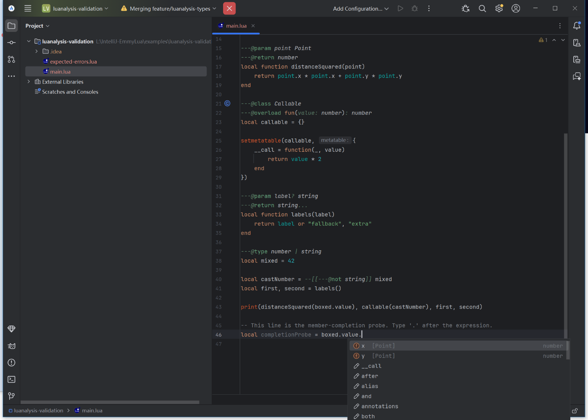
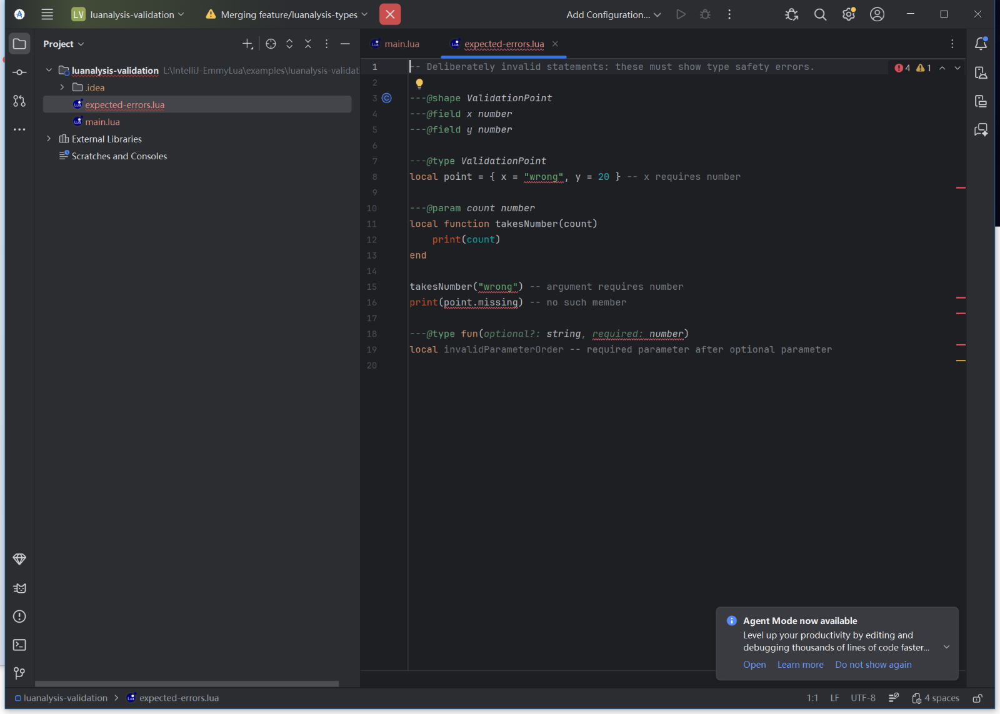
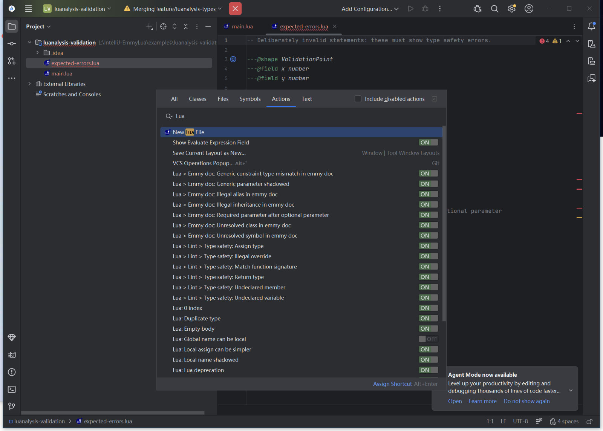

# Validation record

Date: 2026-10-14. Target selected from the user's installed Android Studio,
rather than from a guessed IDE version.

## Environment and artifact

- Android Studio Otter 3 Feature Drop **2025.2.3**.
- Build **AI-252.28238.7.2523.14688667** (IntelliJ Platform 252).
- Windows x64, bundled JBR **21.0.8+-14196175-b1038.72**.
- EmmyLua fork version **1.5.0-luanalysis-IDEA2025.2**, plugin ID **com.tang**.
- Distribution: `build/distributions/IntelliJ-EmmyLua-1.5.0-luanalysis-IDEA2025.2.zip`.
- SHA-256: `CFB0DDB7F21B3442F7549939C55A4D270D15DA0F674220D60685CFBD4E081ECB`.


## Automated checks

The final command used the actual installed IDE as the SDK:

```powershell
$env:JAVA_HOME = 'C:\Program Files\Android\Android_Studio_2025\jbr'
.\gradlew.bat test buildPlugin verifyPlugin `
  -PlocalIdePath='C:/Program Files/Android/Android_Studio_2025' `
  --no-configuration-cache --console=plain
```

The Windows checkout was exposed through an ASCII drive mapping to avoid Java
test-worker argument-file encoding failures on its Chinese path. The provided
`scripts/validate-local.ps1` automates this workaround.

Result: **BUILD SUCCESSFUL**.

- **109 tests passed**, 0 failures, 0 errors, 0 skipped, across 26 suites.
- The type-safety suite alone covers **47** cases, including shapes, constrained
  generics, generic/recursive aliases, indexed fields, callable classes, optional
  parameters, casts, `self`, overloads and variadic results.
- Completion, parser, standard library, language levels, rename, file movement,
  structure, formatting and concurrent local-name resolution tests passed.
- IntelliJ Plugin Verifier **1.410**, against the installed Android Studio:
  **0 compatibility problems**. No failure categories were suppressed.
- The verifier still reports **1 compatibility warning** (the bundled Markdown
  library), **24 deprecated API usages** and **21 experimental API usages**.
  These do not prevent this target from passing, but remain relevant to future
  platform upgrades.
- Every active descriptor implementation was checked against the source tree;
  no missing implementation classes were found.

Machine-readable test results are in [test-summary.json](validation/test-summary.json).
Full local reports remain under `build/reports/tests/test/` and
`build/reports/pluginVerifier/`.

## Native IDE validation

The ZIP was extracted into a separate plugin directory and loaded by the
installed `studio64.exe` using a separate configuration, system and log directory.
This also validates the packaged plugin independently of Gradle's development
sandbox. Startup logs identify the loaded custom plugin as
`EmmyLua (1.5.0-luanalysis-IDEA2025.2)`.

The user's normal configuration and installed EmmyLua were preserved.

- The Lua validation project opened and finished indexing.
- `Box<Point>` member completion offered **x** and **y**, both of type **number**.
- The deliberately invalid sample showed the expected four error categories:
  wrong shape field type, wrong function argument, undeclared member and required
  parameter after an optional parameter.
- The final package was checked for plugin errors during these editor operations.
- The Lua action/inspection catalogue opened without a plugin exception; the
  migrated type-safety and EmmyDoc inspections were registered and enabled.







## Problems addressed during validation

- Old/new PSI representations and obsolete extension registrations were reconciled.
- Live-template context IDs and the brace-entry extension point were updated.
- A base-class initializer constructing a subclass could deadlock parallel
  indexing; global `_G` type creation is now deferred.
- Parallel inspections could build competing declaration trees; their construction
  is serialized per file and covered by a concurrent-resolution regression test.
- Incomplete table arguments now keep overload shape fields available for completion.
- File-move references retain their target in usage records instead of transient
  PSI user data; the move regression test verifies the resulting require paths.
- The code-style provider declares its language, and structure-view sort labels
  have their own resource-bundle entries.
- The archive now has one root directory. Builds no longer reset or clean the
  checkout as part of packaging.
- Tests were adapted to the newer fixture's main-file ordering, progress API and
  OpenTest4J requirement, while retaining their behavior assertions.

## Acceptance boundary

This record proves the installed **252** target. The upstream **262** build
configuration is retained and included in the CI matrix, but it has not been
validated by a local 262 IDE run. Older IntelliJ platform versions, other IDE
products and native debugger sessions were not part of this acceptance run.
CI configuration alone is not evidence of a passing remote run.
